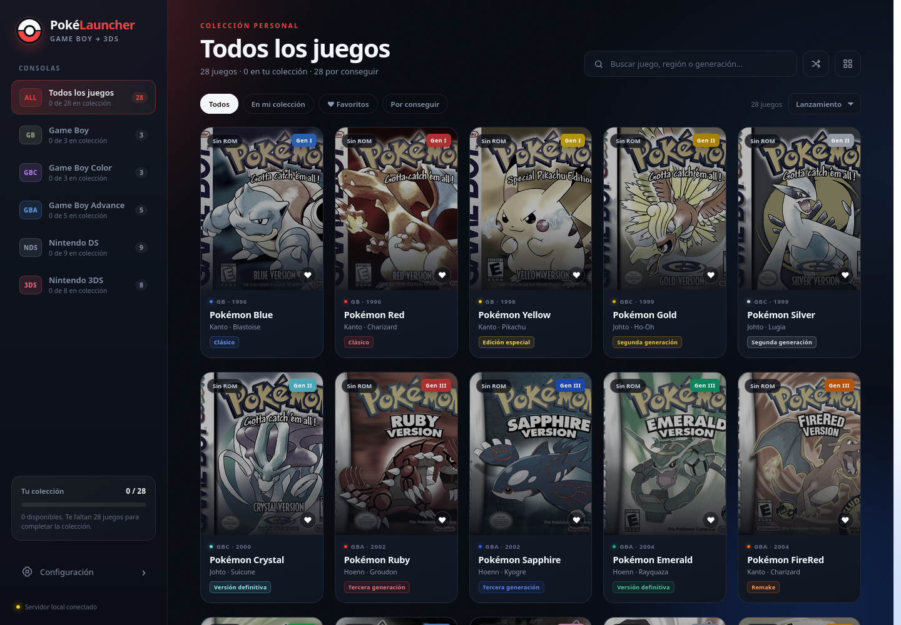
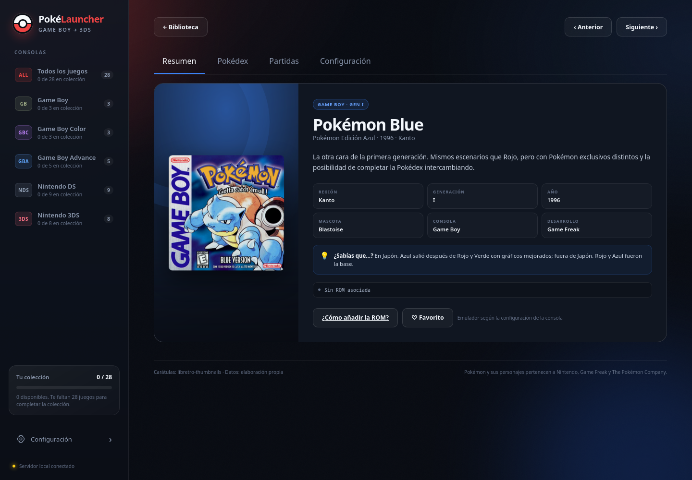
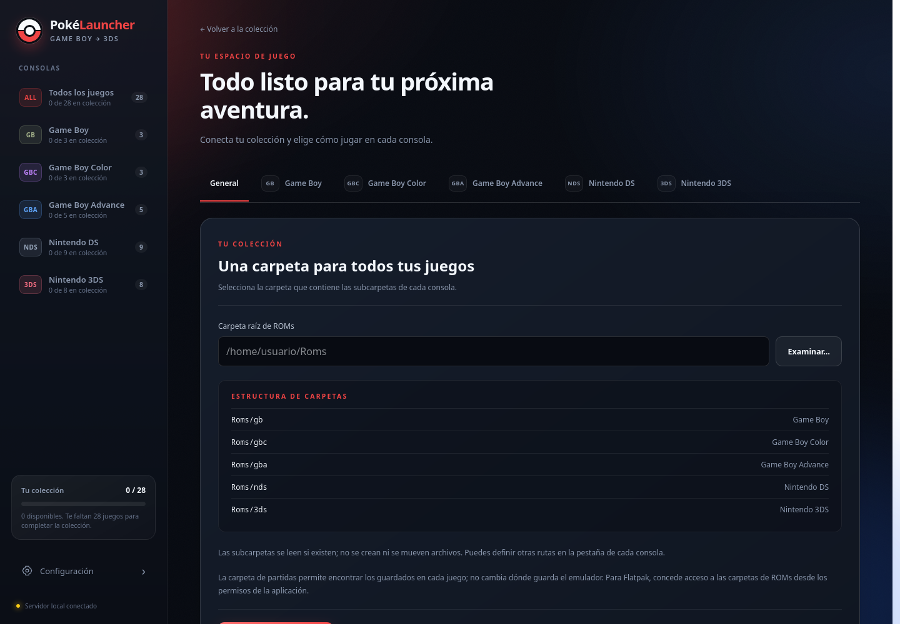

# PokéLauncher

Tu colección de Pokémon, en un solo lugar.

PokéLauncher es un proyecto en desarrollo para reunir tu colección de Pokémon, la Pokédex y tus partidas en una plataforma web.

La propuesta combina una interfaz web con un servicio local en tu equipo. Desde la web podrás explorar tus juegos, consultar tus partidas y abrirlos con los emuladores que ya utilizas; el servicio local será el puente con tus archivos y emuladores.

El prototipo actual permite probar parte de esta experiencia ejecutando la interfaz y el servidor juntos en el equipo. La separación entre la plataforma web y el servicio local todavía está pendiente.

## Un vistazo

### Tu biblioteca

Carátulas, búsqueda y filtros para recorrer los 28 juegos del catálogo, desde Pokémon Red hasta Pokémon Ultra Moon. Organiza tus favoritos y consulta los juegos de tu colección.



### Cada juego tiene su espacio

Abre una ficha para consultar su resumen, acceder a la Pokédex, revisar partidas o elegir la ROM y el emulador con el que jugar.



### Configuración a tu medida

Elige tus carpetas de ROMs y configura emuladores nativos, AppImage o Flatpak para cada consola.



Las capturas muestran el prototipo actual con una configuración nueva, sin ROMs ni partidas personales. La interfaz y las funciones pueden cambiar durante el desarrollo.

## Funciones del prototipo

- **Explorar tu colección:** buscar por nombre, filtrar por consola, ordenar los juegos y guardar favoritos.
- **Lanzar tus juegos:** localizar ROMs en tus carpetas, asociarlas al catálogo y abrirlas con un emulador externo.
- **Consultar la Pokédex:** descargar los paquetes disponibles y después consultar sus fichas sin conexión, con ilustraciones, tipos, estadísticas y movimientos según la edición.
- **Ver tus partidas:** consultar entrenador, equipo y cajas mediante el lector opcional basado en PKHeX.Core. La lectura utiliza una copia y conserva el archivo original.

## Probar la versión en desarrollo

El prototipo se ejecuta actualmente en **Linux con sesión gráfica** y **Python 3.10 o posterior**. Este es el entorno de desarrollo actual; la compatibilidad del futuro servicio local con otros sistemas está por definir. Para jugar también necesitas tus propias ROMs y un emulador compatible instalado.

Desde la carpeta del proyecto, instala las dependencias y arranca la aplicación con el Python del sistema:

```bash
python -m pip install -r requirements.txt
python server.py
```

Si tu distribución administra Python y bloquea la instalación con `pip`, instala Flask y Waitress mediante su gestor de paquetes.

Abre **[http://127.0.0.1:8765](http://127.0.0.1:8765)** en tu navegador. Mantén la terminal abierta mientras usas el launcher; para detenerlo, pulsa `Ctrl+C`.

### Preparar tu colección

1. Abre **Configuración** y elige la carpeta raíz de tus ROMs. Organízalas en subcarpetas `gb`, `gbc`, `gba`, `nds` y `3ds`, o indica una ruta diferente para cada consola.
2. Configura el ejecutable o el ID de Flatpak del emulador para cada consola.
3. Pulsa **Guardar y buscar ROMs**. Las coincidencias claras se asocian automáticamente; puedes elegir las demás desde la configuración de cada juego.
4. Abre un juego y pulsa **Jugar**.

Se admiten emuladores que reciben la ruta de la ROM como argumento, como mGBA, melonDS o Azahar. En Flatpak, el emulador necesita permiso para acceder a tus carpetas. Los archivos ZIP y los paquetes CIA no se extraen ni instalan desde el launcher.

### Activar el visor de partidas

El visor requiere el **SDK de .NET 10** para preparar su lector opcional:

```bash
dotnet publish tools/SaveReader/SaveReader.csproj -c Release -o tools/SaveReader/publish
```

Después, inicia el launcher, configura la carpeta de partidas del emulador y abre la pestaña **Partidas** del juego. La compilación inicial necesita conexión para descargar PKHeX.Core.

## Estado del proyecto

PokéLauncher es un proyecto personal de hobby en desarrollo. El objetivo es ofrecer una plataforma web conectada a un servicio local para acceder a tus partidas y lanzar tus juegos con tus emuladores. La plataforma web independiente y su conexión con el servicio local todavía no están disponibles.

En el prototipo ya están disponibles la biblioteca y el lanzamiento mediante emuladores externos. La Pokédex ofrece paquetes de Kanto y Kalos; el resto de regiones se incorporará progresivamente. El visor de partidas es experimental: se ha comprobado con Pokémon Y y la compatibilidad con las demás ediciones sigue pendiente de validación.

Por ahora, la interfaz y el servidor se ejecutan en tu equipo. En esta versión, la biblioteca y la configuración funcionan sin conexión; la Pokédex necesita Internet para descargar sus recursos por primera vez.

Los ajustes se guardan en `~/.local/share/pokelauncher/` o en la ubicación definida por `XDG_DATA_HOME`. Puedes elegir otra carpeta con `python server.py --data-dir /ruta/a/datos`.

Para más detalles, consulta las [notas técnicas y de desarrollo](docs/notas-desarrollo.md) y el [plan del proyecto](PLAN.md).

## Créditos

Los datos y sprites de la Pokédex proceden de [PokéAPI](https://pokeapi.co/) y [PokeAPI/sprites](https://github.com/PokeAPI/sprites). El lector de partidas utiliza [PKHeX.Core](https://github.com/kwsch/PKHeX), sujeto a su licencia GPL-3.0.

PokéLauncher no incluye ROMs, BIOS, emuladores ni partidas. Pokémon, los nombres y las imágenes de los juegos pertenecen a sus respectivos titulares. Este proyecto no está afiliado a Nintendo, Game Freak ni The Pokémon Company.
